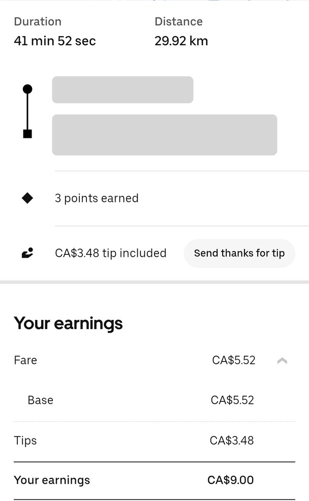
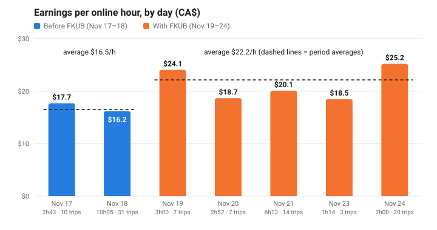
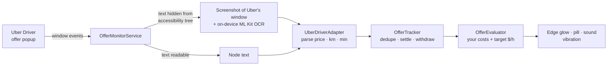

# FKUB · Filter & Kill Underpaid Bids

[](https://github.com/azureservertop-cell/FKUB-Filter-and-Kill-Underpaid-Bids/actions/workflows/android.yml)
[](https://github.com/azureservertop-cell/FKUB-Filter-and-Kill-Underpaid-Bids/releases/download/latest/FKUB-debug.apk)

**English** · [中文](README.zh-CN.md)

> An Android helper for Uber Eats couriers: it reads each delivery offer, checks it against your own numbers and tells you at a glance whether it's worth taking. (Internal codename OfferPilot; the package id stays `com.offerpilot.app` so updates install over older builds.)

Android 11–15 (tested on Android 15) · Kotlin · Jetpack Compose · no root

When Uber Driver pops up a delivery offer, FKUB reads the price, distance and time, evaluates them with your rules, and answers with a **coloured glow around the screen edge**, a small pill showing the estimated net hourly, a tier sound and vibration, all before the offer disappears.

> **Recognition and advice only. It never taps anything.** There is no auto-accept or auto-reject, and the accessibility config declares no gesture capability. Everything is computed on the device. The only network use is downloading public regional fuel prices in Auto fuel-price mode; offers and screenshots never leave the phone.

## Download

On your phone open **Releases → latest** and download [`FKUB-debug.apk`](https://github.com/azureservertop-cell/FKUB-Filter-and-Kill-Underpaid-Bids/releases/download/latest/FKUB-debug.apk). CI rebuilds it on every push to `main`.

1. Install it (allow "install unknown apps").
2. Open FKUB, read the first-run notice (what it reads, that it never taps or uploads) and agree. Then **Status** → **Choose app** and pick the delivery app you drive with (e.g. Uber Driver). Nothing is read until you pick one.
3. **Status** → **Open accessibility settings** → turn on **FKUB**.
   - On Android 13+ a sideloaded app's switch may be greyed out: Settings → Apps → FKUB → ⋮ (top right) → **Allow restricted settings**, then turn it on again.
4. The app is in English by default. Tap **中文** at the top of the Status page to switch the UI and overlay to Chinese.

## Before and after: the author's own numbers

I built FKUB after a 10-hour shift on Nov 18, 2026, and started using it the next day. Until then my strategy was simple: accept every offer that came in, without picking. Since then I take only the offers that meet the standard I set myself. That is the whole difference between the two periods below. The trip that did it: **29.92 km and 41 min 52 s for a CA$5.52 fare** (CA$9.00 with the tip). The fare alone is CA$0.18 per km and about CA$7.90 per hour, before fuel. It is "Offer A" in the rules table below, and far below my own standard.





| | Days | Online | Of which active | Trips | Earnings | Per online hour | Per active hour | Per trip |
|---|---|---|---|---|---|---|---|---|
| Before FKUB | Nov 17–18 | 12 h 48 min | 12 h 24 min | 41 | CA$211.40 | **CA$16.5** | **CA$17.0** | CA$5.16 |
| With FKUB | Nov 19–24 (5 days driven) | 20 h 19 min | 14 h 10 min | 51 | CA$450.10 | **CA$22.2** (+34%) | **CA$31.8** (+86%) | CA$8.83 (+71%) |

The figures are from the Earnings page of the Uber Driver app: total earnings including tips, before fuel and other vehicle costs. Both hourly figures matter:

- **Per online hour (+34%)** counts the time spent waiting for offers too. It is what the shift as a whole paid.
- **Per active hour (+86%)** counts only the time on a trip, which is when the car is moving and burning fuel. To earn CA$100 I was on trips for about 5.9 hours before and 3.1 hours with FKUB, about 47% less time on the road for the same money. **That is where the fuel saving comes from:** fuel and wear are spent while driving, not while waiting, and the trips I now skip are mostly the long low-paid ones like the one above. The shift is also less tiring.
- **Kilometres (about 60% fewer per dollar).** Adding up the distance on each trip's Trip details page: 307.0 km on trips for CA$211.40 before, 258.5 km for CA$449.16 with FKUB. That is **145 km driven per CA$100 before and 58 km with FKUB**, or CA$0.69 → CA$1.74 per km. Counting the fare alone, without tips, it is CA$0.58 → CA$1.05 per km. Fuel burned follows kilometres, so fuel per dollar earned fell by about the same share. Uber's distance covers the drive to the restaurant and to the customer, not the empty driving between orders, so my real total is higher in both periods. (Trip details list 24 and 27 trips, as a stacked order is one entry, and exclude CA$2.18 of incentives, so the totals differ slightly from the Earnings page above.)

With FKUB I declined more offers, so I waited more (active time fell from 97% to 70% of online time) and took fewer trips per hour (3.2 → 2.5), but each trip paid more.

**What Uber actually sent.** FKUB keeps a local log of the offers it reads (price, distance and time only). From Nov 20 to the early hours of Nov 25 it logged 607 reads; after dropping 4 misread prices and merging repeated reads and re-priced re-sends of the same trip, 500 distinct offers remain. **472 of them (94%) were below my own standard** (a CA$17 net hourly target after my vehicle cost, counting 85% of the shown price as certain). The median offer showed CA$0.86 per km and CA$18.4 per hour, which comes to about CA$8.7 per hour once the estimated tip share and vehicle cost are taken off; 65% showed less than CA$1 per km. Before FKUB I accepted all of these. The standard is mine; yours will give a different share.

**Read this as one driver's week, not as a promise.** It is two days against five, in one city, on different weekdays and hours, with no control for demand, weather, promotions or tips. FKUB doesn't change what Uber offers; it only makes it quick to see which offers meet the standard you set yourself. Your numbers will differ.

## How it works



### Reading offers

Phase 0 on a real device (Android 15) showed that **while an offer popup is up, Uber Driver hides its whole UI from the accessibility tree**. So FKUB:

1. watches window events from Uber Driver (`com.ubercab.driver`);
2. when an offer is probably on screen but its text is hidden, takes an accessibility screenshot of **Uber's window only** (`takeScreenshotOfWindow` on Android 14+);
3. runs ML Kit text recognition **on the device**; the bitmap is recycled right away and never saved;
4. parses lines like `CA$5.50` / `including estimated tip` / `15 min (1.3 km) total` / `Accept`, repairing common OCR misreads (e.g. `CA$678` → `CA$6.78`).

This works with Uber in the foreground and when Uber pops an offer over another app (maps, launcher, …). The button may say **Accept** (an offer sent to you, often marked "Exclusive") or **Match** (a Trip Radar offer shown to several drivers); FKUB records which, so the Stats tab can compare them.

**Reading area.** On the Status tab you can limit OCR to a band of the screen (e.g. the lower part, where the card sits). That is faster and keeps map labels out. If the price turns out to be cut off by the band, FKUB reads the whole window once more. Text in capitals from the map (`COMMISSIONERS RD E`) is never taken as part of the address.

**One card, one answer.** While a card stays on screen it is read again about every 0.8 s. A single pass that misses it doesn't hide the result, and for the same price and distance the longer time and the city already read are kept, so the verdict doesn't flip. The glow and pill stay until the offer is gone (or for a fixed number of seconds, if you prefer).

**Trip Radar.** On Uber's Trip Radar list, where several offers are stacked, each card is judged on its own and gets a small coloured badge with its estimated net hourly next to its price. The badges disappear while you scroll and come back at the new positions once the list stops (about a second with OCR). There is no sound or glow on the list, since you are browsing rather than receiving an offer. FKUB does not try to get around Uber hiding its UI.

## Rules (default)

On the **Rules** tab enter your car's **fuel consumption (L/100 km)**, **maintenance ($/100 km)**, fuel price (**Auto** by default: the weekly average for your city from public government data, refreshed about twice a day; or **Manual**), your **target net per hour** (starts at the Ontario minimum wage, $17.95/h from Oct 1, 2026, which changes every Oct 1; set your own) and the **share of the shown price that isn't tip** (default 85%, roughly a 15–18% tip).

```
tip-free pay      = Uber's shown price (incl. estimated tip) × 85%
vehicle cost / km = (L/100km × fuel price + maintenance per 100 km) / 100
required pay      = km × vehicle cost/km + hours × target net hourly
ratio             = tip-free pay / required pay

🔴 red    below target : ratio < 1
🟡 yellow meets target : 1 ≤ ratio < 1.2, i.e. your target net hourly even with no tip
🟢 green  good pay     : 1.2 ≤ ratio < 1.5
🔵 blue   must take    : ratio ≥ 1.5
missing / ambiguous / implausible / low confidence / stale → unknown (no glow, grey pill)
```

85%, 1.2 and 1.5 are all adjustable. FKUB has no shared or "recommended" standard: the starting numbers are examples, the app asks you to enter your own, and each driver decides by their own numbers. The Rules tab also lists, for your car, the minimum price Uber has to show for each tier at different times and distances.

Example numbers, not a recommendation, without the 2-min waiting time (10 L/100 km, $1.36/L, $10/100 km maintenance → $0.236/km; $17.95/h → $0.299/min; 85% tip-free):

| Offer | Shown · distance · time | Tip-free | Required | Ratio | Est. net hourly | Verdict |
|---|---|---|---|---|---|---|
| A | $9 · 29.92 km · 42 min | $7.65 | $19.63 | 0.39 | $0.84/h | 🔴 below target |
| B | $33.01 · 40.99 km · 63 min | $28.06 | $28.52 | 0.98 | $17.51/h | 🔴 below target (short by $0.46) |
| C | $7 · 3 km · 10 min | $5.95 | $3.70 | 1.61 | $31.45/h | 🔵 must take |
| Real | $5.50 · 1.3 km · 15 min | $4.68 | $4.79 | 0.98 | $17.47/h | 🔴 below target (short by $0.12) |

Under **Advanced** you can switch to the simple rule from the original spec, `max(km × $0.80, min × $0.50)` (also applied to the tip-free pay).

These are your personal filter rules, not Uber's pay standard. Minimum-earnings guarantees are calculated per pay period and are not included in single offers.

## Alerts

**Waiting for food** (Rules tab, default 2 min, 0 turns it off): added to every offer's time, since Uber's estimate doesn't include waiting at the restaurant.

**Shop orders** (on by default, Rules tab): Uber's time for a Shop order doesn't include picking the items, so when the card shows "N items", N × 1.5 min (adjustable) is added (N = items, i.e. different products; you can switch to units, e.g. "22 items (30 units)") to the time before judging. Verified on a real "Shop & Deliver" card ("8 items (8 units)"; the item count is used). If the item count isn't read, the offer is judged on Uber's time alone.

**Out-of-town alert** (on by default, Rules tab): when the city in the drop-off address (e.g. `Sunset Rd, St Thomas`) isn't one of your cities, the pill shows `⚠ St Thomas · Net $17/h`, a reminder to watch the empty return. Only whole city names are compared, never streets, neighbourhoods or postal codes. Your cities default to the fuel-price city; add nearby towns you're happy with, e.g. `London, Thamesford`. If the card shows no city, there's no alert. By default it doesn't change the verdict; turn on **Count the drive back** to multiply an out-of-town offer's distance and time by a return multiplier (default 1.5, i.e. the trip plus half again for the empty drive back) before judging it.

| Tier | Edge glow | Sound (built-in) | Vibration |
|---|---|---|---|
| 🔵 must take | blue | meme air horn | three pulses |
| 🟢 good pay | green | coin | one pulse |
| 🟡 meets target | yellow | none | two pulses |
| 🔴 below target | red | wet fart | one long |

The pill shows only the estimated net hourly, e.g. `Net $17/h`. Each tier's sound can be turned off, given its own volume, previewed or replaced with your own audio file. Built-in clips come from free asset packs, see [SOUND_CREDITS.md](SOUND_CREDITS.md).

## App tabs

- **Status**: language, app to watch (picked from your installed apps), OCR reading area (e.g. only the lower part of the screen, shown on the real screen while you adjust it), service state, last recognition, vibration / glow / pill / OCR / debug switches, sounds.
- **Rules**: car costs, target earnings, tier thresholds, price table, simple-rule mode.
- **Stats**: a log of every offer FKUB read (time, shown price, km, minutes, whether it was an Accept or Match offer, and a Shop order's item counts), re-judged with your current rules: this week's share of offers below your own standard (vs last week), Accept vs Match comparison (count, median price, $/km, net hourly and share meeting your standard for direct offers vs Trip Radar offers), tier split, price vs distance scatter, net-hourly histogram, offers by hour of day and a recent list, for today / 7 days / 30 days / all. Logging is on by default and can be switched off, cleared or exported as CSV.
- **Mock**: test the rules without Uber (spec cases A/B/C) or paste screen text to test the adapter; previews the real overlay when the service is on.
- **Debug** (developer only: tap the version number at the bottom of Status 7 times): target package, continuous capture (one tap to start, one to stop, zipped for sharing, with a `trace.txt` of every read and why a result was or wasn't shown), single snapshots, capture list.

## Architecture

```
core/   pure Kotlin/JVM, no Android dependency, unit-tested
  model/     DeliveryOffer, EvaluationResult, Verdict, ScreenText
  parser/    OfferParser (money / distance / time, OCR repair), OfferAdapter, UberDriverAdapter (single card + Trip Radar list),
             DropoffCity (city of the drop-off line, out-of-town check)
  rules/     OfferEvaluator, EvaluatorSettings
  tracking/  OfferTracker (dedupe, settle time for incomplete offers, withdraw when gone)
  fuel/      FuelPriceCsv (public fuel-price data parsing)
  stats/     OfferRecord, OfferStats (history re-evaluated with the current rules)
  format/    OfferMessages (pill / detail text, English + Chinese)
  i18n/      Lang
  OfferPipeline  recognize → track → evaluate

app/    Android
  accessibility/  OfferMonitorService, NodeReader, MonitorState
  capture/        ScreenOcr (accessibility screenshot + ML Kit)
  overlay/        OverlayController, EdgeGlowView (TYPE_ACCESSIBILITY_OVERLAY, not touchable)
  feedback/       SoundPlayer, Haptics
  settings/       AppSettings, SettingsRepository (DataStore)
  debug/          SnapshotStore
  history/        OfferHistory (offer log CSV in app-private storage)
  action/         OfferActionHandler (no-op only)
  ui/             Compose screens
```

`OfferEvaluator` only takes a `DeliveryOffer` and knows nothing about accessibility; when Uber changes its UI only `UberDriverAdapter` / `UberAdapterConfig` need updating. The adapter uses no view IDs.

### Failing safe

- Only windows of the app(s) you picked are read (none until you pick one); other apps are seen by package name only, to notice that you left Uber. OCR captures only Uber's window.
- Missing price / distance / time, indistinguishable candidates, several accept buttons, implausible values (≤ 0, huge, average speed > 130 km/h), confidence < 0.6 or data older than 30 s → **unknown**.
- When the popup disappears or you switch apps, the glow and pill are removed (within about two reads when the card was read by OCR).
- The same offer isn't announced twice within 20 s; incomplete offers get 0.7 s to fill in before "incomplete" is reported.
- A screen only counts as an offer if it has the **Accept** button or the "estimated tip" label, so Uber's trip history and earnings pages (which also show prices, km and minutes) are ignored. A window that keeps showing no offer is OCR'd at most every 2 s, and only while the screen is changing; an unreadable window that may belong to another app, at most every 15 s.
- Events are throttled (≤ 1 read per 150 ms), nodes are read on a worker thread with a 1500-node cap, OCR runs at most every 0.8 s, and every error degrades to "no offer" without affecting Uber Driver.

## Building

```bash
./gradlew :core:test              # core unit tests (JDK 17+ only)
./gradlew :app:assembleDebug      # needs Android SDK 35
```

CI (`.github/workflows/android.yml`) runs the tests, builds the APK and publishes it to the `latest` release on every push to `main`.

## Tests

`core/src/test` has over 120 unit tests, many of them built from real cards drivers reported (whole-dollar prices like `CA$7`, `1 hr 10 min`, Shop & Deliver with items and units, Chinese restaurant names, map labels around the card): price / distance / duration parsing (`$9.00`, `29.92 km`, `1 hr 3 min`, miles), missing and malformed values, negative / zero / huge values, multiple amounts, formula boundaries, tip deduction, return-trip cost, adapter ambiguity, real-device offer text and OCR misread repair, dedupe, offer disappearance, ignoring trip-history screens, drop-off city and out-of-town matching, Trip Radar lists, offer statistics, fuel-price CSV parsing, and the English / Chinese messages.

Integration checks that need a real device are listed in [docs/PHASE0.md](docs/PHASE0.md).

## Privacy

The only network requests are for public fuel-price data in Auto mode (Ontario open data, falling back to Statistics Canada); they only download whole public datasets, and your city is matched on the phone. Switch fuel price to Manual and the app makes no network requests at all. Screenshots are processed in memory and never saved by default. The offer log keeps only time, price, km, minutes, Accept or Match, and a Shop order's item counts in app-private storage (it is deleted with the app, and you can clear it or turn it off on the Stats tab). Debug snapshots are only saved when you start a capture (or turn on auto snapshot) and stay on the phone in `Android/data/com.offerpilot.app/files/snapshots/`. Addresses are never uploaded. In normal use they are never saved or logged: the out-of-town alert compares the drop-off city in memory and discards it. Only the hidden developer options (off by default) can save screen text, which may include addresses; it stays on the phone. Names and order numbers are not read.

## Status and limitations

- Verified on one phone (nubia, Android 15) in London and Toronto, Ontario, with Canadian-dollar offers in English, light and dark theme: Delivery, Delivery (2), Shop & Deliver, Exclusive / Accept, Match and the Trip Radar list. Other languages and regions haven't been seen yet; the adapter answers "unknown" rather than guessing.
- OCR needs Android 14+ for window-only screenshots; Android 11–13 fall back to a full screenshot cropped to Uber's window.
- Auto fuel price uses government regional averages (weekly for Ontario cities, monthly from Statistics Canada elsewhere), so it lags the pump by days to weeks. The data layouts are discovered at runtime; if a source changes, the app keeps the last price and shows the error.
- The rolling `latest` build is a debug build signed with a public debug key kept in the repo (`app/fkub-debug.keystore`), for testing only. Versioned releases (tags `v*`) are signed with a private release key; see [docs/RELEASING.md](docs/RELEASING.md). The two use different keys, so switching between them needs one uninstall.

## Disclaimer

FKUB is an independent project and is not affiliated with, endorsed by or sponsored by Uber. Uber is a trademark of its owner.

## License

FKUB is free for drivers and couriers, and it must stay that way. It is source-available under the [PolyForm Noncommercial License 1.0.0](LICENSE), with an extra permission for any driver or courier to use it on their own phone for their own delivery work.

- Free to use, read, change and share for noncommercial purposes.
- Not allowed: selling it or a changed version, paid or subscription versions, ads, bundling it into a paid product, or any other commercial use.
- Changed versions must not use the FKUB name or icon.

This is not an OSI "open source" license, because it forbids commercial use on purpose.

## Credits

The approach (watch UI events → read accessibility nodes → match rules) is inspired by GKD; no GKD code is used. Sound credits are in [SOUND_CREDITS.md](SOUND_CREDITS.md).
