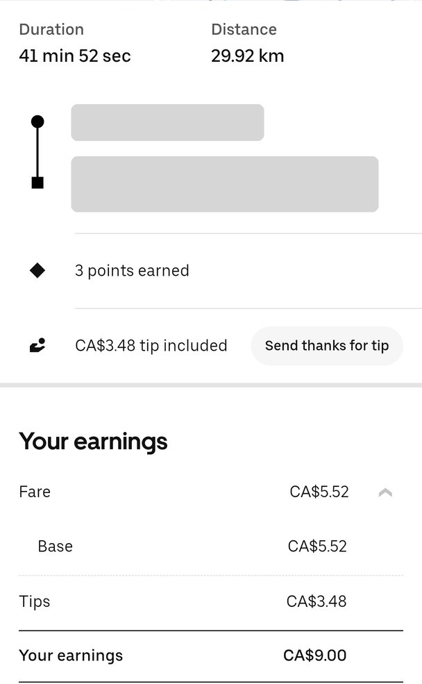
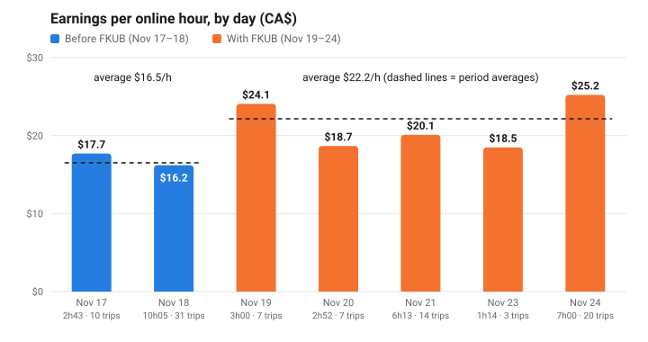

# FKUB · Filter & Kill Underpaid Bids

[](https://github.com/azureservertop-cell/FKUB-Filter-and-Kill-Underpaid-Bids/actions/workflows/android.yml)
[](https://github.com/azureservertop-cell/FKUB-Filter-and-Kill-Underpaid-Bids/releases/download/latest/FKUB-debug.apk)

[English](README.md) · **中文**

> Uber Eats 送餐订单筛选助手：读取每一单的报价，按你自己的标准算一遍，一眼看出值不值得接。（内部代号 OfferPilot，包名 `com.offerpilot.app` 保持不变，方便覆盖安装。）

Android 11–15（已在 Android 15 真机测试）· Kotlin · Jetpack Compose · 无需 Root

Uber Driver 弹出配送订单时，FKUB 读取报价、距离和时间，按你的规则计算，在订单消失前给出结论：**屏幕边缘发光**、显示预估净时薪的小提示条、档位音效，以及可选的语音播报和震动。

> **只识别、只建议，不会点击。** 不会自动接单或拒单，无障碍配置里也没有声明手势能力。全部计算在本机完成。唯一的联网是“自动油价”模式下载政府公开的地区平均油价，订单和截图都不会离开手机。

## 下载

在手机上打开仓库的 **Releases → latest**，下载 [`FKUB-debug.apk`](https://github.com/azureservertop-cell/FKUB-Filter-and-Kill-Underpaid-Bids/releases/download/latest/FKUB-debug.apk)。每次推送 main 后 CI 会自动更新。

1. 安装（需要允许“安装未知应用”）。
2. 打开 FKUB，阅读首次说明（读取什么、不会点击、不会上传）并同意。然后「状态」→「选择应用」，选你跑单用的应用（例如 Uber Driver）。没选之前不会读取任何内容。
3. 「状态」→「打开系统无障碍设置」→ 开启 **FKUB**。
   - Android 13+ 侧载应用的开关如果是灰色：系统设置 → 应用 → FKUB → 右上角 ⋮ → **允许受限设置**，再回去开启。
4. App 默认英文。在「状态」页顶部点 **中文**，界面、提示条和语音都会切成中文。

## 使用前后：作者自己的数据

2026 年 11 月 18 日跑完 10 小时后，我决定做 FKUB，第二天开始用。让我下决心的是这一单：**29.92 公里、41 分 52 秒，车费 CA$5.52**（加小费一共 CA$9.00）。只算车费是每公里 CA$0.18、每小时约 CA$7.90，还没扣油钱。它就是下面规则表里的“订单 A”，远低于我自己的标准。





| | 日期 | 在线 | 其中送单（Active） | 单数 | 收入 | 每在线小时 | 每送单小时 | 每单 |
|---|---|---|---|---|---|---|---|---|
| 用 FKUB 之前 | 11 月 17–18 日 | 12 小时 48 分 | 12 小时 24 分 | 41 | CA$211.40 | **CA$16.5** | CA$17.0 | CA$5.16 |
| 用 FKUB 之后 | 11 月 19–24 日（跑了 5 天） | 20 小时 19 分 | 14 小时 10 分 | 51 | CA$450.10 | **CA$22.2**（+34%） | CA$31.8（+86%） | CA$8.83（+71%） |

数字来自 Uber Driver 的 Earnings 页面：含小费的总收入，没扣油费和其他车辆成本。**每在线小时**把等单的时间也算进去，是更公道的比较；**每送单小时**只算手上有单的时间。用了之后我拒掉更多单，等单时间变多了（送单时间占在线时间从 97% 降到 70%），每小时接的单也少了（3.2 → 2.5），但每一单的收入更高，车也少跑了很多路。

**这只是一个司机一周的数据，不是保证。** 2 天对比 5 天，同一个城市，星期几和时段都不一样，也没有排除需求、天气、平台奖励和小费的影响。FKUB 不会改变 Uber 派什么单，它只是让你一眼看出哪些单达到你自己定的标准。你的结果会不一样。

## 订单是怎么读出来的

Phase 0 真机（Android 15）验证发现：**订单弹窗出现时，Uber Driver 会把整个界面从无障碍树里隐藏**。所以 FKUB：

1. 监听 Uber Driver（`com.ubercab.driver`）的窗口事件；
2. 判断“疑似有订单但文字被隐藏”时，用无障碍截图**只截 Uber 的窗口**（Android 14+ 用 `takeScreenshotOfWindow`）；
3. 用 ML Kit 在**本机**识别文字，截图用完立即回收，不保存；
4. 解析 `CA$5.50` / `including estimated tip` / `15 min (1.3 km) total` / `Accept` 这类文字，并修正常见的 OCR 误读（如 `CA$678` → `CA$6.78`）。

Uber 在前台、或在地图 / 桌面等其他应用上方弹单时都能识别。接单按钮可能是 **Accept**（直接派给你的单，常带“Exclusive”）或 **Match**（Trip Radar 上多个司机都能看到的单）；FKUB 会记下是哪一种，「统计」页可以对比。

**读取范围。** 在「状态」页可以把 OCR 限制在屏幕的一段（比如卡片所在的下半部分），识别更快，也不会读到地图上的字。如果价格刚好被范围裁掉，FKUB 会自动再读一次整个窗口。地图上全大写的地名（如 `COMMISSIONERS RD E`）不会被当成地址的一部分。

**一张单一个结果。** 卡片在屏幕上时，大约每 0.8 秒重读一次。偶尔一次没读到不会收起结果；价格和公里数相同的单，保留较长的时间和已读到的城市，所以结论不会来回跳。发光和提示条会一直显示到订单消失（也可以改成固定秒数）。

**Trip Radar。** 在 Uber 的 Trip Radar 列表里，几张订单卡片叠在一起，每张都会单独计算，并在价格旁边显示一个带颜色的小标记，写着预估净时薪。滑动列表时标记会先消失，停下后在新位置重新出现（用 OCR 时大约一秒）。列表界面不播音效、不语音、不发光，因为这时你是在浏览订单，不是收到新单。FKUB 不会绕过 Uber 的隐藏机制。

## 计算规则（默认）

在「规则」页填：**百公里油耗**、**百公里维护费用**、油价（默认**自动**：按你所在城市从政府公开数据获取每周平均价，每天约更新两次；也可以改成**手动**）、**期望每小时净赚**（初始值是安省最低工资，2026 年 10 月 1 日起为 $17.95/h，每年 10 月 1 日调整；请改成你自己的目标），以及**显示价中不含小费的比例**（默认 85%，约等于 15–18% 小费）。

```
不含小费价     = Uber 显示价（含预估小费）× 85%
每公里车辆成本 = (百公里油耗 × 油价 + 百公里维护费) / 100
达标价         = 公里 × 每公里车辆成本 + 小时 × 期望净时薪
比值           = 不含小费价 / 达标价

🔴 红 不达标：比值 < 1
🟡 黄 刚好达标：1 ≤ 比值 < 1.2，即不含小费也能达到你的目标净时薪
🟢 绿 比较赚：1.2 ≤ 比值 < 1.5
🔵 蓝 无脑接：比值 ≥ 1.5
数据缺失 / 歧义 / 不合理 / 置信度低 / 过期 → 无法判断（不发光，灰色提示条）
```

85%、1.2、1.5 都可以手动调。FKUB 没有统一或“推荐”的标准：初始数字只是示例，App 会提示你填自己的数字，每个司机按自己的标准决定。「规则」页会按你的车自动列出不同时长 / 距离下，Uber 至少要显示多少钱才进入每一档。

示例数字，不是推荐标准，未加 2 分钟等餐时间（油耗 10 L/100km、油价 $1.36/L、维护 $10/100km → $0.236/km；$17.95/h → $0.299/分钟；不含小费 85%）：

| 订单 | 显示价 · 距离 · 时间 | 不含小费 | 达标价 | 比值 | 预计净时薪 | 结论 |
|---|---|---|---|---|---|---|
| A | $9 · 29.92km · 42min | $7.65 | $19.63 | 0.39 | $0.84/h | 🔴 不达标 |
| B | $33.01 · 40.99km · 63min | $28.06 | $28.52 | 0.98 | $17.51/h | 🔴 不达标（差 $0.46） |
| C | $7 · 3km · 10min | $5.95 | $3.70 | 1.61 | $31.45/h | 🔵 无脑接 |
| 真实 | $5.50 · 1.3km · 15min | $4.68 | $4.79 | 0.98 | $17.47/h | 🔴 不达标（差 $0.12） |

「规则」页的「高级」里可以切回最初需求里的简单规则 `max(公里 × $0.80, 分钟 × $0.50)`（同样先扣小费）。

这是你自己的筛选规则，不是 Uber 官方报酬标准。最低收入保障按结算周期计算，没有加进单笔报价。

## 提示方式

**等餐时间**（在「规则」页，默认 2 分钟，设为 0 即关闭）：每单都会加上，因为 Uber 给的时间不含在餐厅等餐。

**Shop 购物单**（默认开启，在「规则」页）：Uber 给 Shop 单的时间不含挑商品的时间，所以卡片上显示“N items”时，判断前会加上 N × 1.5 分钟（可调；N 默认按 items 即商品种类数，也可改成按 units 总件数，例如 “22 items (30 units)”）。已用真机上的“Shop & Deliver”卡片验证（“8 items (8 units)”，按 items 计算）；读不到商品数量时，只按 Uber 给的时间判断。

**跨城提醒**（默认开启，在「规则」页）：目的地地址里的城市（如 `Sunset Rd, St Thomas`）不是你设置的城市时，提示条显示 `⚠ St Thomas · 净 $17/h`，语音加一句“跨城单，去 St Thomas，注意空驶回程”。只比对完整的城市名，不看街道、街区或邮编。城市默认用油价城市，可以加上你不介意的周边城镇，例如 `London, Thamesford`。卡片上没有城市名时不提醒。默认不影响档位判断；打开「计入回城距离」后，跨城单的距离和时间会先乘以回城距离倍率（默认 1.5，即原路程再加一半作为空驶回城）再判断。

| 档位 | 边缘发光 | 内置音效 | 震动 |
|---|---|---|---|
| 🔵 无脑接 | 蓝 | meme 气笛“嘟嘟嘟” | 三下 |
| 🟢 比较赚 | 绿 | 金币 | 一下 |
| 🟡 刚好达标 | 黄 | 无 | 两下 |
| 🔴 不达标 | 红 | 拉稀 | 长震 |

提示条只显示预估净时薪，例如 `净 $17/h`。每一档的音效都可以单独开关、调音量、试听或换成自己的音频文件。内置音效来自免费素材包，见 [SOUND_CREDITS.md](SOUND_CREDITS.md)。

## App 页面

- **状态**：语言、要识别的应用（从已安装应用中选）、OCR 读取范围（比如只读屏幕下半部分，调整时会在真实屏幕上显示范围）、服务状态、最近一次识别、语音 / 震动 / 发光 / 提示条 / OCR / 调试开关、音效。
- **规则**：车辆成本、期望收入、档位阈值、报价表、简单规则模式。
- **统计**：FKUB 读到的每一单都会记录（只存时间、显示价、公里、分钟、是 Accept 还是 Match 单，以及 Shop 单的商品数量），并按当前规则重新判断：本周低于你自己标准的订单占比（对比上周）、Accept 对比 Match（直接派单和 Trip Radar 订单各自的单数、中位价、每公里价、净时薪和达标率）、档位分布、价格 vs 距离散点图、净时薪分布、各时段订单和最近订单列表，可选今天 / 7 天 / 30 天 / 全部。默认开启，可以关闭、清空或导出 CSV。
- **模拟**：不开 Uber 也能测试规则（需求文档案例 A/B/C），或粘贴屏幕文字测试适配器；服务开启时可直接预览真实的悬浮层和语音。
- **调试**（仅供开发者：在「状态」页底部连点版本号 7 次才会出现）：目标包名、持续抓取（点一下开始、点一下结束，自动打包 zip 方便分享，里面的 `trace.txt` 记录每次读到了什么、为什么显示或没显示）、单次快照、抓取记录。

## 架构、安全降级、构建、测试

见 [英文 README](README.md#architecture)。要点：`core/` 是纯 Kotlin 模块（解析、规则、跟踪、中英文文案），`app/` 是无障碍服务、OCR、悬浮层和界面；适配器不使用任何控件 ID；任何数据缺失或歧义都输出“无法判断”；屏幕上必须有 Accept 按钮或“estimated tip”字样才算订单，所以 Uber 的历史行程和收入页面不会被当成订单，持续没有订单的窗口最多每 2 秒 OCR 一次，而且只在屏幕有变化时才读；可能属于其他应用的不可读窗口最多每 15 秒一次；订单消失或切换应用时立即撤下提示。

## 隐私

唯一的网络请求是自动油价模式下获取公开油价数据（安大略省开放数据，取不到时用加拿大统计局），只下载整份公开数据，城市是在手机上匹配的。把油价改成“手动”后，App 完全不联网。截图只在内存中处理，默认不保存。订单记录只保存时间、价格、公里、分钟、是 Accept 还是 Match，以及 Shop 单的商品数量，放在 App 私有目录（卸载即删除，也可以在「统计」页清空或关闭）。调试快照只在你主动开始抓取（或开启自动快照）时保存在手机的 `Android/data/com.offerpilot.app/files/snapshots/`。地址永远不上传。正常使用时不保存、不记录：跨城提醒只在内存中比对目的地城市，比完即丢弃。只有隐藏的开发者选项（默认关闭）会保存屏幕文字，可能包含地址，只存在手机上。不读取姓名和订单号。

## 现状与限制

- 只在一台手机（nubia，Android 15）上验证过，地点是安大略省伦敦市和多伦多，报价是加元、英文界面，浅色和深色主题都见过：Delivery、Delivery (2)、Shop & Deliver、Exclusive / Accept、Match 和 Trip Radar 列表。其他语言或地区的 Uber 界面还没见过，适配器遇到不认识的情况会输出“无法判断”，不会乱猜。
- 只截 Uber 窗口需要 Android 14+；Android 11–13 截全屏后裁剪到 Uber 窗口。
- 自动油价用的是政府公布的地区平均价（安大略省城市每周更新，其他地方用加拿大统计局的月度数据），会比实际油价晚几天到几周。数据格式是运行时自动识别的，来源格式变了也会保留上次的价格并显示错误。
- 滚动更新的 `latest` 是调试版，用仓库里公开的调试签名（`app/fkub-debug.keystore`），仅供测试。正式版本（标签 `v*`）用私有的发布签名，见 [docs/RELEASING.md](docs/RELEASING.md)。两者签名不同，互相切换需要先卸载一次。

## 免责声明

FKUB 是独立项目，与 Uber 无任何关联，也未获其认可或赞助。Uber 是其所有者的商标。

## 许可证

FKUB 对司机和骑手永久免费。代码公开，采用 [PolyForm Noncommercial License 1.0.0](LICENSE)，并额外允许任何司机或骑手在自己的手机上用它跑单。

- 允许：以非商业目的免费使用、阅读、修改和分享。
- 不允许：出售本软件或修改版、做收费或订阅版、加广告、打包进收费产品，或任何其他商业用途。
- 修改版不得使用 FKUB 的名字和图标。

因为刻意禁止商业用途，它不属于 OSI 定义的“开源许可证”，而是“源码公开”。

## 致谢

思路（监听界面 → 读取无障碍节点 → 匹配规则）参考了 GKD，但没有使用 GKD 代码。音效来源见 [SOUND_CREDITS.md](SOUND_CREDITS.md)。
